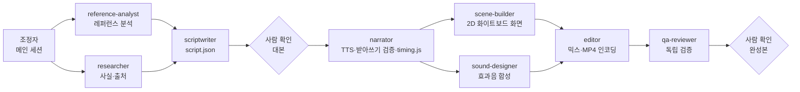

# reference-style-video-agents

**한국어** · [中文](#中文)

레퍼런스 영상의 **형식**을 분석해, 다른 주제의 설명 영상을 만드는 Claude Code 멀티에이전트 파이프라인입니다.
첫 작품: **「시간을 더 잘 쓰는 5가지 습관」** — 손그림 화이트보드 스타일, 한국어 남성 내레이션, 2분 50초.

▶ 완성 영상: [`demo/time-habits-v3.mp4`](demo/time-habits-v3.mp4)

> **AI 음성 고지**: 이 영상의 내레이션은 AI 음성 합성(Supertonic 2)으로 만든 기계 생성 음성입니다.

## 결과물

| 항목 | 값 |
|-|-|
| 규격 | 1920×1080, 30fps, H.264 + AAC |
| 길이 | 170.05초 (목표 2~3분, 180초 이하) |
| 문장 / 문자 카드 | 60문장 / 9장 |
| 화면 | 60개 장면, 직접 컷 전환, 노란 번호판 5개, 자막 바 없음 |
| 소리 | 남성 음색 M3(속도 0.9) + 효과음 147개, 배경음악 없음 |
| 검증 | 완성 MP4를 문장별로 받아써서 대본과 비교: 58/60 일치 (나머지 2문장은 표기 차이·사람이 직접 청취 확인) |
| 사실 출처 | 25개, 모두 URL 기록 ([`research/facts.md`](projects/time-habits/research/facts.md)) |

## 멀티에이전트 구조

메인 세션이 조정자가 되어 8개의 서브에이전트에게 일을 나누고, 에이전트끼리는 프로젝트 폴더의 **파일**로만 결과를 주고받습니다.



- **동시 실행**: `reference-analyst` ∥ `researcher`, `scene-builder` ∥ `sound-designer`
- **사람이 멈춰서 확인하는 지점**: 대본·사실, 음색, 완성본
- 역할 정의: [`.claude/agents/`](.claude/agents) · 작업 방법: [`SKILL.md`](.claude/skills/reference-style-video/SKILL.md) · 규칙: [`AGENTS.md`](AGENTS.md)

| 에이전트 | 하는 일 | 산출물 |
|-|-|-|
| reference-analyst | 레퍼런스의 비율·컷 간격·문자 카드·소리 구성 측정 | `analysis/reference.md` |
| researcher | 주제의 사실을 검색하고 출처 기록 | `research/facts.md` |
| scriptwriter | 한 줄 한 문장 한국어 대본 | `script.json` |
| narrator | 문장마다 여러 벌 합성 → 받아쓰기로 일치하는 벌만 채택 | `assets/voice/`, `timing.js` |
| scene-builder | 2D canvas 손그림 화이트보드 화면 | `index.html` |
| sound-designer | Web Audio로 효과음 4종 합성 | `assets/sfx/` |
| editor | 내레이션+효과음 믹스, 브라우저 안에서 MP4 인코딩 | `out/*.mp4`, `CREDITS.txt` |
| qa-reviewer | 완성본을 다시 열어 길이·화면·소리·받아쓰기 검증 | `qa/report-v3.md` |

## 실행

```bash
sh tools/setup.sh        # Supertonic 2 음성 모델(약 250MB) 다운로드 — 저장소에는 포함하지 않음
claude                   # 이 폴더에서 Claude Code 실행 (서브에이전트 8개가 로드됨)
```

Claude Code에게:

```
[레퍼런스 영상 주소]를 받아서 형식을 분석하고,
"[주제]"를 주제로 비슷한 형식의 영상을 만들어 줘.
reference-style-video 스킬과 AGENTS.md 규칙을 따라 줘.
```

브라우저 조작(음성 합성·받아쓰기·인코딩)에는 Playwright MCP가 필요합니다: `claude mcp add playwright -s user -- npx @playwright/mcp@latest`

## 크레딧

- 작업 흐름·도구 스크립트(`scripts/`)·예시: 성균관대 영상 생성 프로젝트 세미나 3회차 자료
- 음성 합성: [Supertonic 2](https://huggingface.co/Supertone/supertonic-2) (Supertone, BigScience Open RAIL-M) — 기계 생성 음성임을 밝혀야 함
- 음성 인식: [Whisper small](https://huggingface.co/onnx-community/whisper-small) (transformers.js, WebGPU)
- 글꼴: [Gaegu](https://github.com/google/fonts/tree/main/ofl/gaegu) (SIL OFL 1.1)
- 효과음: 이 프로젝트에서 직접 합성 (외부 음원 없음)
- 레퍼런스: The English Class, "Learn How to Think In English" — 형식(구성·화풍)만 참고했고, 화면·소리·음악은 사용하지 않았으며 원본 파일은 저장소에 포함하지 않음

---

## 中文

分析参考视频的**形式**，制作另一个主题讲解视频的 Claude Code 多智能体流水线。
第一部作品：**「让你更好安排时间的 5 个习惯」**——手绘白板风格，韩语男声旁白，2 分 50 秒。

▶ 成片：[`demo/time-habits-v3.mp4`](demo/time-habits-v3.mp4)

> **AI 语音声明**：本视频的旁白是用 AI 语音合成（Supertonic 2）生成的机器语音。

### 成果

| 项目 | 数值 |
|-|-|
| 规格 | 1920×1080，30fps，H.264 + AAC |
| 时长 | 170.05 秒（目标 2～3 分钟，不超过 180 秒） |
| 句数 / 文字卡 | 60 句 / 9 张 |
| 画面 | 60 个画面，直接硬切，5 个黄色编号牌，没有字幕条 |
| 声音 | 男声 M3（语速 0.9）+ 147 个音效，没有背景音乐 |
| 验证 | 把成片音频按句转写并与文案比对：58/60 一致（另 2 句为写法差异，已由人亲耳确认） |
| 事实出处 | 25 条，全部记录 URL |

### 多智能体结构

主会话担任调度者，把工作分给 8 个子代理；子代理之间只通过项目文件夹里的**文件**交接。

- **同时运行**：`reference-analyst` ∥ `researcher`，`scene-builder` ∥ `sound-designer`
- **停下来由人确认**：文案与事实、音色、成片
- 角色定义：`.claude/agents/` · 工作方法：`.claude/skills/reference-style-video/SKILL.md` · 规则：`AGENTS.md`

### 运行

```bash
sh tools/setup.sh        # 下载 Supertonic 2 语音模型（约 250MB），仓库里不包含
claude                   # 在本文件夹启动 Claude Code（会加载 8 个子代理）
```

然后把上面韩文部分的提示词发给 Claude Code，替换方括号里的参考视频地址和主题。

### 致谢

- 工作流程、工具脚本、示例：成均馆大学视频生成项目研讨会第 3 讲资料
- 语音合成：Supertonic 2（Supertone，BigScience Open RAIL-M），须注明是机器生成的语音
- 语音识别：Whisper small（transformers.js，WebGPU）
- 字体：Gaegu（SIL OFL 1.1）
- 音效：本项目自行合成，未使用外部音源
- 参考视频：The English Class，"Learn How to Think In English"——只借鉴形式（结构、画风），未使用其画面、声音、音乐，原片不包含在仓库中
